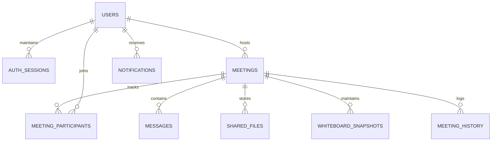

# CONNECTLY — Database Schema & Data Models

## 1. Database Philosophy & Principles

CONNECTLY utilizes **MongoDB** (hosted on MongoDB Atlas) as its primary data store. The data architecture follows modern document database design principles:
1. **Appropriate Normalization vs. Embedding:** High-write transaction data (e.g., chat messages, participants, whiteboard deltas) are stored in dedicated collections to prevent document bloat and respect MongoDB's 16MB document size limit. Low-churn configuration and preference sub-documents are embedded.
2. **Defensive Validation:** Strict schema-level validation via Mongoose alongside runtime Zod validation.
3. **Optimized Indexing:** Compound indexes tailored for high-frequency queries (e.g., meeting participants, room messages ordered by timestamp).
4. **Data Privacy by Design:** Passwords hashed with Argon2id; refresh tokens hashed; zero raw media or stream data stored in MongoDB.

---

## 2. Entity Relationship Overview



---

## 3. Collections Specification

### 3.1. Collection: `users`
- **Purpose:** Stores authenticated user identities, credentials, profile details, and baseline device preferences.
- **Relationships:** Referenced by `meetings.hostId`, `messages.senderId`, `shared_files.uploaderId`, `meeting_participants.userId`.

#### Fields & Types
| Field | Type | Required | Description |
| :--- | :--- | :--- | :--- |
| `_id` | `ObjectId` | Yes | Primary user identifier |
| `email` | `String` | Yes | Unique lowercase email address |
| `passwordHash` | `String` | Yes | Argon2id cryptographic hash string |
| `firstName` | `String` | Yes | User first name (1–50 chars) |
| `lastName` | `String` | Yes | User last name (1–50 chars) |
| `avatarUrl` | `String` | No | Cloudinary / S3 URL for profile picture |
| `isEmailVerified` | `Boolean` | Yes | Default: `false` |
| `emailVerificationToken` | `String` | No | Hashed verification token |
| `passwordResetToken` | `String` | No | Hashed reset token |
| `passwordResetExpires` | `Date` | No | Expiration timestamp (15m window) |
| `preferences` | `Object` | Yes | Embedded user preferences (see sample) |
| `createdAt` | `Date` | Yes | Timestamp of account registration |
| `updatedAt` | `Date` | Yes | Timestamp of last account modification |

#### Indexes
- `{ email: 1 }` (Unique, Collation: `{ locale: 'en', strength: 2 }`)
- `{ passwordResetToken: 1 }` (Sparse)
- `{ createdAt: -1 }`

#### Sample Document
```json
{
  "_id": "6650a12f84b3e8a1d044a101",
  "email": "sarah.chen@connectly.io",
  "passwordHash": "$argon2id$v=19$m=65536,t=3,p=1$q9oH2qP4tW...$3b9W1bK0v...",
  "firstName": "Sarah",
  "lastName": "Chen",
  "avatarUrl": "https://res.cloudinary.com/connectly/image/upload/v1726000000/avatars/user_6650a12f84b3e8a1d044a101.webp",
  "isEmailVerified": true,
  "preferences": {
    "defaultAudioMuted": true,
    "defaultVideoOff": false,
    "enableVirtualBackground": false,
    "theme": "editorial-light",
    "notificationSounds": true
  },
  "createdAt": "2026-05-15T09:30:00.000Z",
  "updatedAt": "2026-05-15T09:30:00.000Z"
}
```

---

### 3.2. Collection: `auth_sessions`
- **Purpose:** Tracks active refresh token sessions to enable revocation and audit sign-in telemetry.
- **Relationships:** Belongs to `users`.

#### Fields & Types
| Field | Type | Required | Description |
| :--- | :--- | :--- | :--- |
| `_id` | `ObjectId` | Yes | Unique session ID |
| `userId` | `ObjectId` | Yes | Foreign key to `users` |
| `refreshTokenHash` | `String` | Yes | SHA-256 hash of issued refresh token |
| `userAgent` | `String` | No | Browser / client identifier string |
| `ipAddress` | `String` | No | IP address of sign-in request |
| `isValid` | `Boolean` | Yes | Default: `true`; toggled to `false` on revocation |
| `expiresAt` | `Date` | Yes | TTL field for MongoDB auto-deletion (7 days) |
| `createdAt` | `Date` | Yes | Timestamp of creation |

#### Indexes
- `{ userId: 1, isValid: 1 }`
- `{ refreshTokenHash: 1 }` (Unique)
- `{ expiresAt: 1 }` (TTL index: `expireAfterSeconds: 0`)

#### Sample Document
```json
{
  "_id": "6650b24084b3e8a1d044b202",
  "userId": "6650a12f84b3e8a1d044a101",
  "refreshTokenHash": "e3b0c44298fc1c149afbf4c8996fb92427ae41e4649b934ca495991b7852b855",
  "userAgent": "Mozilla/5.0 (Windows NT 10.0; Win64; x64) AppleWebKit/537.36 Chrome/130.0.0.0",
  "ipAddress": "198.51.100.42",
  "isValid": true,
  "expiresAt": "2026-05-22T09:30:00.000Z",
  "createdAt": "2026-05-15T09:30:00.000Z"
}
```

---

### 3.3. Collection: `meetings`
- **Purpose:** Primary entity representing scheduled, active, or past meeting rooms, including governance rules and security parameters.
- **Relationships:** `hostId` references `users`.

#### Fields & Types
| Field | Type | Required | Description |
| :--- | :--- | :--- | :--- |
| `_id` | `ObjectId` | Yes | MongoDB primary key |
| `meetingCode` | `String` | Yes | Canonical human-readable room ID (e.g., `cly-789-qwa`) |
| `title` | `String` | Yes | Meeting title (max 120 chars) |
| `description` | `String` | No | Optional agenda or notes |
| `hostId` | `ObjectId` | Yes | Foreign key to `users` |
| `status` | `String` | Yes | `scheduled` \| `active` \| `ended` \| `cancelled` |
| `passcodeHash` | `String` | No | Optional Argon2/SHA-256 hashed 6-digit passcode |
| `settings` | `Object` | Yes | Embedded meeting constraints (see sample) |
| `scheduledStartTime` | `Date` | No | Planned start time for scheduled meetings |
| `actualStartTime` | `Date` | No | Timestamp when host launched the room |
| `actualEndTime` | `Date` | No | Timestamp when host terminated the room |
| `livekitRoomSid` | `String` | No | Internal LiveKit Room SID |
| `createdAt` | `Date` | Yes | Creation timestamp |
| `updatedAt` | `Date` | Yes | Modification timestamp |

#### Indexes
- `{ meetingCode: 1 }` (Unique)
- `{ hostId: 1, status: 1 }`
- `{ scheduledStartTime: 1 }` (For calendar lookups)
- `{ status: 1 }`

#### Sample Document
```json
{
  "_id": "6650c35084b3e8a1d044c303",
  "meetingCode": "cly-789-qwa",
  "title": "Quarterly Engineering Roadmap & Architecture Sync",
  "description": "Deep-dive into LiveKit SFU capacity and whiteboard engine.",
  "hostId": "6650a12f84b3e8a1d044a101",
  "status": "active",
  "passcodeHash": "$argon2id$v=19$m=65536,t=3,p=1$7f...$9a...",
  "settings": {
    "waitingRoomEnabled": true,
    "defaultMuteOnEntry": true,
    "allowScreenShare": true,
    "allowChat": true,
    "allowWhiteboard": true,
    "allowFileUploads": true,
    "maxParticipants": 60,
    "autoRecord": false
  },
  "scheduledStartTime": "2026-05-15T10:00:00.000Z",
  "actualStartTime": "2026-05-15T10:01:14.000Z",
  "livekitRoomSid": "RM_cly789qwa_9812",
  "createdAt": "2026-05-14T14:00:00.000Z",
  "updatedAt": "2026-05-15T10:01:14.000Z"
}
```

---

### 3.4. Collection: `meeting_participants`
- **Purpose:** Tracks real-time roster, role, connection status, and device states of participants in an active or concluded meeting.
- **Relationships:** `meetingId` references `meetings`; `userId` references `users` (or `null` for guests).

#### Fields & Types
| Field | Type | Required | Description |
| :--- | :--- | :--- | :--- |
| `_id` | `ObjectId` | Yes | Unique participant record ID |
| `meetingId` | `ObjectId` | Yes | Foreign key to `meetings` |
| `userId` | `ObjectId` | No | Foreign key to `users` (`null` if guest) |
| `displayName` | `String` | Yes | Name displayed on video tile |
| `role` | `String` | Yes | `host` \| `co-host` \| `participant` \| `guest` |
| `status` | `String` | Yes | `waiting` \| `admitted` \| `in-meeting` \| `left` \| `ejected` |
| `isAudioMuted` | `Boolean` | Yes | Default: `true` |
| `isVideoEnabled` | `Boolean` | Yes | Default: `false` |
| `isScreenSharing` | `Boolean` | Yes | Default: `false` |
| `isHandRaised` | `Boolean` | Yes | Default: `false` |
| `handRaisedAt` | `Date` | No | Timestamp of hand raise (for queue order) |
| `socketId` | `String` | No | Current active Socket.IO socket identifier |
| `livekitIdentity` | `String` | Yes | Unique identity passed to LiveKit SDK |
| `joinedAt` | `Date` | Yes | Timestamp of initial join |
| `leftAt` | `Date` | No | Timestamp when session ended |

#### Indexes
- `{ meetingId: 1, status: 1 }`
- `{ meetingId: 1, userId: 1 }`
- `{ socketId: 1 }` (Sparse)
- `{ meetingId: 1, isHandRaised: 1, handRaisedAt: 1 }`

#### Sample Document
```json
{
  "_id": "6650d46084b3e8a1d044d404",
  "meetingId": "6650c35084b3e8a1d044c303",
  "userId": "6650a12f84b3e8a1d044a101",
  "displayName": "Sarah Chen (Host)",
  "role": "host",
  "status": "in-meeting",
  "isAudioMuted": false,
  "isVideoEnabled": true,
  "isScreenSharing": false,
  "isHandRaised": false,
  "socketId": "sio_w4k9812_host",
  "livekitIdentity": "usr_6650a12f84b3e8a1d044a101",
  "joinedAt": "2026-05-15T10:01:15.000Z"
}
```

---

### 3.5. Collection: `messages`
- **Purpose:** Stores text chat messages and rich emoji reactions sent during a meeting.
- **Relationships:** `meetingId` references `meetings`; `senderId` references `users`.

#### Fields & Types
| Field | Type | Required | Description |
| :--- | :--- | :--- | :--- |
| `_id` | `ObjectId` | Yes | Message primary key |
| `meetingId` | `ObjectId` | Yes | Foreign key to `meetings` |
| `senderId` | `ObjectId` | No | Foreign key to `users` (or null if guest) |
| `senderName` | `String` | Yes | Snapshot of sender display name |
| `recipientId` | `ObjectId` | No | Optional recipient for private 1-on-1 DM (`null` = public) |
| `content` | `String` | Yes | Sanitized text body (max 2000 chars) |
| `type` | `String` | Yes | `public` \| `direct` \| `system` |
| `attachments` | `Array` | No | Array of linked `fileId` references |
| `isDeleted` | `Boolean` | Yes | Default: `false` (soft deletion for moderation) |
| `createdAt` | `Date` | Yes | Creation timestamp |

#### Indexes
- `{ meetingId: 1, createdAt: 1 }`
- `{ meetingId: 1, recipientId: 1 }`

#### Sample Document
```json
{
  "_id": "6650e57084b3e8a1d044e505",
  "meetingId": "6650c35084b3e8a1d044c303",
  "senderId": "6650a12f84b3e8a1d044a101",
  "senderName": "Sarah Chen",
  "recipientId": null,
  "content": "Please review the architecture diagram in the shared files tab.",
  "type": "public",
  "attachments": ["6650f68084b3e8a1d044f606"],
  "isDeleted": false,
  "createdAt": "2026-05-15T10:05:22.000Z"
}
```

---

### 3.6. Collection: `shared_files`
- **Purpose:** Metadata records for documents and assets shared in meeting rooms and persisted in private S3/R2 storage.
- **Relationships:** `meetingId` references `meetings`; `uploaderId` references `users`.

#### Fields & Types
| Field | Type | Required | Description |
| :--- | :--- | :--- | :--- |
| `_id` | `ObjectId` | Yes | File record primary key |
| `meetingId` | `ObjectId` | Yes | Foreign key to `meetings` |
| `uploaderId` | `ObjectId` | No | User who uploaded the file |
| `uploaderName` | `String` | Yes | Display name snapshot |
| `originalFileName`| `String` | Yes | Original file name (sanitized) |
| `storageKey` | `String` | Yes | Secure S3/R2 object key (`meetings/{id}/{uuid}.ext`) |
| `mimeType` | `String` | Yes | Verified MIME type |
| `fileSizeBytes` | `Number` | Yes | File size in bytes (max 26,214,400 = 25MB) |
| `virusScanStatus` | `String`| Yes | `pending` \| `clean` \| `flagged` |
| `createdAt` | `Date` | Yes | Upload confirmation timestamp |

#### Indexes
- `{ meetingId: 1, createdAt: -1 }`
- `{ storageKey: 1 }` (Unique)

#### Sample Document
```json
{
  "_id": "6650f68084b3e8a1d044f606",
  "meetingId": "6650c35084b3e8a1d044c303",
  "uploaderId": "6650a12f84b3e8a1d044a101",
  "uploaderName": "Sarah Chen",
  "originalFileName": "architecture_v1.pdf",
  "storageKey": "meetings/cly-789-qwa/9bf7e324-4b51-412e-9d21-f18287e02e1a.pdf",
  "mimeType": "application/pdf",
  "fileSizeBytes": 4821040,
  "virusScanStatus": "clean",
  "createdAt": "2026-05-15T10:04:10.000Z"
}
```

---

### 3.7. Collection: `whiteboard_snapshots`
- **Purpose:** Stores periodic consolidated vector state and thumbnail snapshots of the collaborative whiteboard to facilitate instant hydration for late joiners and post-meeting review.
- **Relationships:** `meetingId` references `meetings`.

#### Fields & Types
| Field | Type | Required | Description |
| :--- | :--- | :--- | :--- |
| `_id` | `ObjectId` | Yes | Primary key |
| `meetingId` | `ObjectId` | Yes | Foreign key to `meetings` |
| `version` | `Number` | Yes | Monotonically incrementing vector revision counter |
| `elements` | `Array` | Yes | Array of vector elements (strokes, shapes, text) |
| `thumbnailUrl` | `String` | No | Rendered PNG thumbnail stored in S3/Cloudinary |
| `isLocked` | `Boolean` | Yes | Lock state controlled by host |
| `updatedAt` | `Date` | Yes | Timestamp of snapshot generation |

#### Indexes
- `{ meetingId: 1, version: -1 }`

#### Sample Document
```json
{
  "_id": "6651079084b3e8a1d0440707",
  "meetingId": "6650c35084b3e8a1d044c303",
  "version": 42,
  "elements": [
    {
      "id": "elem_101",
      "type": "rectangle",
      "x": 120,
      "y": 80,
      "width": 240,
      "height": 160,
      "strokeColor": "#172B3A",
      "fillColor": "#DCEDE8",
      "strokeWidth": 2
    },
    {
      "id": "elem_102",
      "type": "freedraw",
      "points": [[120, 80], [140, 95], [165, 110]],
      "strokeColor": "#168B83",
      "strokeWidth": 3
    }
  ],
  "thumbnailUrl": "https://s3.connectly.io/meetings/cly-789-qwa/whiteboard_thumb_v42.png",
  "isLocked": false,
  "updatedAt": "2026-05-15T10:18:00.000Z"
}
```

---

### 3.8. Collection: `meeting_history`
- **Purpose:** Permanent historical log for completed meetings, capturing aggregate analytics (total attendees, duration, participant roster with attendance durations).
- **Relationships:** `meetingId` references `meetings`; `hostId` references `users`.

#### Fields & Types
| Field | Type | Required | Description |
| :--- | :--- | :--- | :--- |
| `_id` | `ObjectId` | Yes | History record primary key |
| `meetingId` | `ObjectId` | Yes | Foreign key to `meetings` |
| `meetingCode` | `String` | Yes | Meeting room code |
| `title` | `String` | Yes | Final meeting title |
| `hostId` | `ObjectId` | Yes | Foreign key to `users` |
| `startTime` | `Date` | Yes | Actual start timestamp |
| `endTime` | `Date` | Yes | Actual termination timestamp |
| `durationSeconds` | `Number` | Yes | Total duration in seconds |
| `totalParticipants`| `Number` | Yes | Unique participant count |
| `roster` | `Array` | Yes | Array of participant summaries (see sample) |
| `filesSharedCount` | `Number` | Yes | Total count of files uploaded |
| `createdAt` | `Date` | Yes | Record creation timestamp |

#### Indexes
- `{ hostId: 1, startTime: -1 }`
- `{ meetingId: 1 }` (Unique)
- `{ "roster.userId": 1, startTime: -1 }` (For participant history queries)

#### Sample Document
```json
{
  "_id": "665118a084b3e8a1d0441808",
  "meetingId": "6650c35084b3e8a1d044c303",
  "meetingCode": "cly-789-qwa",
  "title": "Quarterly Engineering Roadmap & Architecture Sync",
  "hostId": "6650a12f84b3e8a1d044a101",
  "startTime": "2026-05-15T10:01:14.000Z",
  "endTime": "2026-05-15T10:55:30.000Z",
  "durationSeconds": 3256,
  "totalParticipants": 14,
  "roster": [
    {
      "userId": "6650a12f84b3e8a1d044a101",
      "displayName": "Sarah Chen",
      "role": "host",
      "durationSeconds": 3256
    },
    {
      "userId": "6650b99984b3e8a1d044b999",
      "displayName": "Marcus Vance",
      "role": "participant",
      "durationSeconds": 3100
    }
  ],
  "filesSharedCount": 2,
  "createdAt": "2026-05-15T10:55:31.000Z"
}
```

---

### 3.9. Collection: `notifications`
- **Purpose:** Stores user alerts (e.g., meeting invitations, schedule reminders, role promotions).
- **Relationships:** `userId` references `users`.

#### Fields & Types
| Field | Type | Required | Description |
| :--- | :--- | :--- | :--- |
| `_id` | `ObjectId` | Yes | Primary key |
| `userId` | `ObjectId` | Yes | Target user |
| `title` | `String` | Yes | Notification heading |
| `message` | `String` | Yes | Description text |
| `type` | `String` | Yes | `meeting_invite` \| `meeting_reminder` \| `system` |
| `linkUrl` | `String` | No | Deep link destination |
| `isRead` | `Boolean` | Yes | Default: `false` |
| `createdAt` | `Date` | Yes | Notification timestamp |

#### Indexes
- `{ userId: 1, isRead: 1, createdAt: -1 }`
- `{ createdAt: 1 }` (TTL index: 30 days retention)
