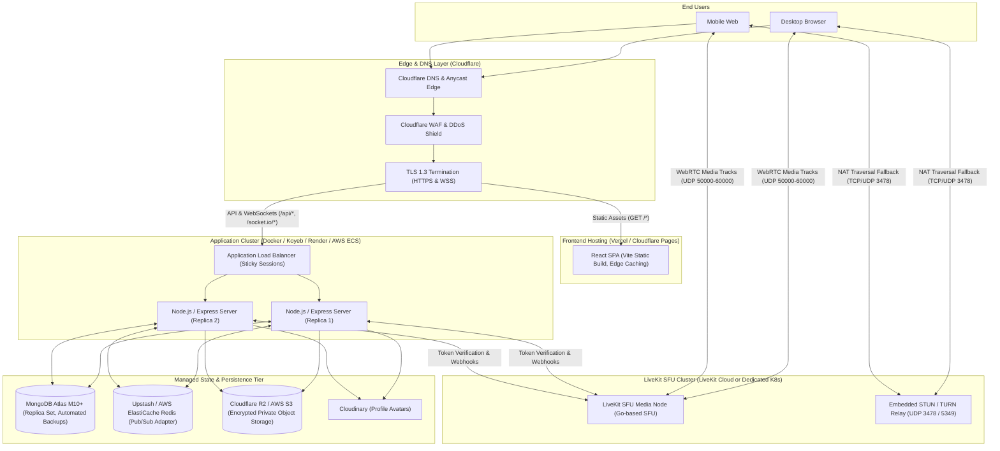

# CONNECTLY — Production Deployment Architecture & Infrastructure

## 1. Cloud Infrastructure Topology

CONNECTLY is architected for a multi-cloud or hybrid-cloud containerized deployment that optimizes for low-latency WebRTC media routing, edge-accelerated frontend delivery, and resilient database clustering.



---

## 2. Infrastructure Component Specifications

### 2.1. Frontend Hosting (React SPA)
- **Target Platform:** **Vercel** or **Cloudflare Pages**.
- **Build Output:** Static production build (`vite build` ➔ `/dist`).
- **CDN Edge Strategy:** Immutable caching headers on hashed assets (`Cache-Control: public, max-age=31536000, immutable`), `index.html` configured with `Cache-Control: no-cache` for instant rolling updates.

### 2.2. Backend Application Tier (Node.js & Socket.IO)
- **Target Platform:** **Koyeb Web Service** (validated primary platform for zero-budget showcase) or **Render / AWS ECS (Fargate)** containerized deployment (see [DEPLOYMENT_GUIDE.md](file:///c:/Users/SANJEET%20CHAUHAN/Desktop/code%20Alpha/antigravity%20communication%20application/docs/DEPLOYMENT_GUIDE.md)).
- **Initial Showcase Baseline (`max_scale = 1`):** Zero-budget deployments run strictly as a single backend container instance to align with free-tier quotas (Koyeb Free Tier `1` service, Upstash Free `500k` commands/month).
- **Packaging:** Multi-stage Docker image built on `node:24-alpine`:
  - Stage 1: Build & TypeScript compilation (`tsc`).
  - Stage 2: Minimal runtime image running as non-root user (`USER node`).
- **Clustering & Sticky Sessions:** Application Load Balancer enforces cookie-based sticky sessions for the WebSocket upgrade handshake. Socket.IO instances sync state via `@socket.io/redis-adapter`.
- **Mandatory Prerequisites Before Horizontal Scaling (>1 Backend Replica):**
  1. **Shared HTTP Rate-Limit Store:** Migrate `express-rate-limit` instances in `server/src/middlewares/rateLimiter.ts` and `readinessLimiter` in `server/src/routes/health.routes.ts` from process-local `MemoryStore` to a shared Redis store (`rate-limit-redis`) so per-IP quotas are enforced globally rather than multiplied per replica.
  2. **Distributed Whiteboard Serialization:** Replace or supplement `WhiteboardService.opQueues` (process-local `Map` mutex in `server/src/services/whiteboard.service.ts`) with a Redis distributed lock or meeting-affinity routing so concurrent multi-replica mutations do not exhaust `WHITEBOARD_MAX_OCC_RETRIES = 5`.
  3. **Cursor Admission Caching / Read Reduction:** Replace per-event `Meeting.findOne` + `MeetingParticipant.findOne` queries on `whiteboard:cursor` (`server/src/realtime/meetingSocket.ts`, up to `30/sec` per socket) with a short-TTL admission cache invalidated by revocation events, avoiding excess Atlas read load at multi-instance scale.

### 2.3. LiveKit SFU Infrastructure
- **Deployment Model:**
  - *Option A (Recommended for rapid production):* **LiveKit Cloud** (Global anycast media mesh with automated geo-routing, managed STUN/TURN relays, and high availability).
  - *Option B (Self-Hosted for dedicated VPC):* **Dedicated Kubernetes Cluster (AWS EKS or DigitalOcean)** running official LiveKit Server Docker images on compute-optimized instances (e.g., `c6i.xlarge` or `c7g.xlarge` with high network bandwidth).
- **Networking Requirements:**
  - Signaling: TCP `7880` (or reverse-proxied over `443`).
  - WebRTC UDP media range: UDP `50000–60000`.
  - STUN/TURN: UDP/TCP `3478`, TLS `5349`.

### 2.4. Database: MongoDB Atlas
- **Tier:** Dedicated M10 or serverless cluster with automatic vertical scaling.
- **High Availability:** 3-node Replica Set (Primary with 2 Secondary nodes across availability zones).
- **Security:**
  - Strict IP Access Whitelist or AWS VPC Peering.
  - Encryption at rest (AES-256).
  - TLS 1.3 enforced for all client connections (`mongodb+srv://...`).
  - Automated continuous backups with 7-day point-in-time recovery (PITR).

### 2.5. File Storage Tier (Cloudflare R2 / AWS S3)
- **Configuration:** Private bucket; public access blocked completely.
- **Server-Side Encryption:** SSE-S3 or AWS KMS managed encryption keys.
- **CORS Configuration:**
  ```json
  [
    {
      "AllowedHeaders": ["*"],
      "AllowedMethods": ["PUT", "GET"],
      "AllowedOrigins": ["https://connectly.io"],
      "ExposeHeaders": ["ETag"],
      "MaxAgeSeconds": 3000
    }
  ]
  ```

---

## 3. Environment & Secret Management

- **Secrets Injection:** Environment variables are managed using a central secret manager (**Doppler** or **Infisical**) during CI/CD.
- **Runtime Guard:** The backend application enforces schema validation on all environment variables at process bootstrap via `src/config/env.ts`. If any required secret (`MONGODB_URI`, `JWT_ACCESS_SECRET`, `LIVEKIT_API_SECRET`) is missing or malformed, the process exits immediately with code `1`.
- **Zero Secrets in Source Control:** `.env` files are strictly excluded via `.gitignore`.

---

## 4. Observability, Logging & Error Tracking

| Observability Domain | Selected Solution | Role & Integration |
| :--- | :--- | :--- |
| **Error Tracking** | **Sentry** (Client & Server) | Captures unhandled exceptions, WebRTC connection drops, and breadcrumb trails. |
| **Application Logging** | **Pino + Datadog / BetterStack** | High-performance JSON logging with automated redaction of auth tokens and PII. |
| **SFU Telemetry** | **LiveKit Analytics / Prometheus** | Monitors participant jitter, packet loss, bitrate graphs, and connection quality. |
| **Uptime Monitoring** | **BetterStack / Checkly** | Synthetic browser checks verifying user login and room generation every 60 seconds. |

---

## 5. Phase 01 Boundary Notice

> **STRICT COMPLIANCE:** This document defines the deployment architecture for future phases. **Zero infrastructure, cloud resources, databases, or hosting services shall be provisioned or deployed during Phase 01.**
