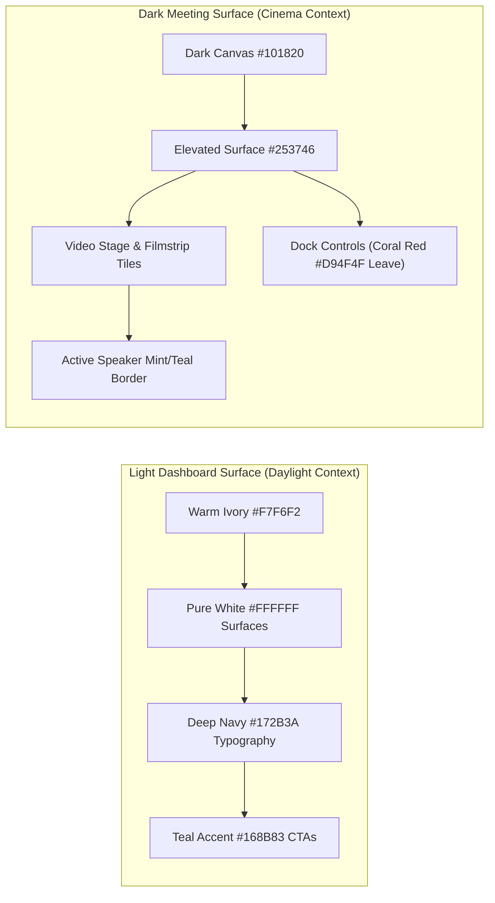

# CONNECTLY — Design System Architecture & Specification
## Phase 02: UI/UX Design System Foundation

---

## 1. Executive Summary & Design Vision

CONNECTLY is a premium, real-time video communication and collaboration web application. The platform is designed to support rich interactive meetings (featuring dynamic video grids for up to an architectural target of 60 participants, real-time messaging, collaborative whiteboards, and private file sharing) while providing a distinct, human-designed aesthetic.

### 1.1. Core Identity & Philosophy: "Modern Editorial + Premium Collaboration SaaS"

The platform deliberately rejects the generic, homogenized visual tropes of modern AI-generated SaaS prototypes—specifically oversaturated neon purple-to-orange gradients, heavy illegible glassmorphism (`backdrop-blur-3xl`), random floating background particles, and hyper-rounded cards without functional hierarchy.

Instead, CONNECTLY is styled under an **Editorial + Precision Engineering** paradigm:
- **Calm, High-Readability Editorial Hierarchy:** Rooted in clean publication design with purposeful whitespace, deliberate content pacing, and sharp typographic geometry.
- **Dual-Surface Contextual Architecture:**
  1. **Light Dashboard Shell (Warm Ivory `#F7F6F2` + Pure White `#FFFFFF`):** A bright, airy, distraction-free environment for asynchronous productivity: scheduling meetings, reviewing session histories, inspecting shared documents, and managing account preferences.
  2. **Elevated Dark Meeting Theater (`#101820` Dark Canvas + `#253746` Elevated Surface):** An immersive, low-eye-fatigue cinematic interface that focuses the user's attention on human video feeds, high-contrast screen shares, and collaborative whiteboard vector strokes during prolonged sessions.
- **Functional, Purposeful Motion:** Micro-interactions that visually reinforce state changes (e.g., active speaker audio pulses, smooth grid reflow, drawer transitions) without introducing disorientation or consuming GPU resources needed for WebRTC decoding.

---

## 2. Product Identity & Emotional Resonance

```
┌─────────────────────────────────────────────────────────────────────────────┐
│                           CONNECTLY BRAND PILLARS                           │
├───────────────┬─────────────────────────────────────────────────────────────┤
│ Pillar        │ Manifestation in Design System                              │
├───────────────┼─────────────────────────────────────────────────────────────┤
│ **Trust**     │ Unambiguous status indicators, transparent role permissions,│
│               │ and prominent security badges (meeting lock, waiting room). │
│ **Clarity**   │ Crisp typographical scale, minimum 4.5:1 contrast, and zero │
│               │ visual clutter competing with active video streams.         │
│ **Speed**     │ Lightweight layout shells, instantaneous tactile feedback,  │
│               │ and predictable keyboard navigation shortcuts.              │
│ **Comfort**   │ Deep, non-glare meeting theater canvas (`#101820`) designed │
│               │ specifically to prevent eye strain during 60+ min meetings. │
└───────────────┴─────────────────────────────────────────────────────────────┘
```

---

## 3. Dual-Surface Design Architecture



### 3.1. Surface Context Differentiation
- **Light Dashboard:** Used across all administrative and preparation screens: Landing Page, Authentication, User Dashboard, Meeting Scheduling, Session History, Shared Downloads, and Profile Settings. It conveys clarity, organization, and openness.
- **Dark Theater:** Used exclusively within the active conference room, screen-sharing stage, and collaborative whiteboard. By reducing surface luminance, video feeds become the focal element and battery consumption on OLED displays is minimized.

---

## 4. Strict Prohibited Anti-Patterns (Design Guardrails)

The following design treatments are strictly forbidden across all screens and components:
1. ❌ **No Heavy Glassmorphism:** Heavy blurs degrade rendering framerates and reduce contrast. Frosting is restricted to subtle header backdrops (`backdrop-blur-md` with `80%` opacity).
2. ❌ **No Random Gradients:** Backgrounds must remain flat and calm. Multi-stop purple/pink gradients are banned.
3. ❌ **No Floating Particle Physics:** Decorative floating background canvas elements are prohibited.
4. ❌ **No Color-Only State Indicators:** Statuses (e.g., mute, online, error) must pair color with an explicit icon or textual label to satisfy WCAG 2.2 accessibility.
5. ❌ **No Jarring Layout Shifts:** Video tiles joining or leaving must animate dimensions using physics-based layout transitions rather than popping abruptly.

---

## 5. Design System Directory Structure & Documentation Map

Phase 02 design assets and specifications are organized as follows:

```
docs/
├── DESIGN_SYSTEM.md                        # Master architectural overview & rules (This Document)
├── COLOR_TYPOGRAPHY_TOKENS.md              # Complete token specification & contrast math
├── COMPONENT_LIBRARY_SPECIFICATION.md      # Atomic & composite component specifications
├── SCREEN_DESIGN_SPECIFICATION.md          # Complete blueprints for all 23 product screens
├── RESPONSIVE_DESIGN_GUIDELINES.md         # Breakpoints, touch targets, and layout transformations
├── ANIMATION_INTERACTION_GUIDELINES.md     # Motion physics, easing curves, and reduced motion
├── ACCESSIBILITY_GUIDELINES.md             # WCAG 2.2 AA audit matrix, focus & keyboard models
├── USER_FLOWS.md                           # 20 detailed user journeys and edge cases
├── MEETING_ROOM_DESIGN_SPECIFICATION.md    # Dedicated deep-dive into the meeting room
├── DESIGN_REVIEW_CHECKLIST.md              # 15-point quality and consistency review
├── PHASE_02_ACCEPTANCE.md                  # Verification audit and sign-off
└── design-references/                      # Visual ASCII & SVG architectural screen mockups
    ├── DASHBOARD_LAYOUT.md
    ├── MEETING_ROOM_LAYOUT.md
    ├── PREJOIN_LOBBY_LAYOUT.md
    └── MOBILE_RESPONSIVE_LAYOUT.md
```

---

## 6. Cross-Phase Tracking & Design Governance

Phase 02 delivers the complete visual and interaction design blueprints. Actual implementation of features belongs strictly to future phases according to the fixed 18-phase roadmap:

| Product Capability | Design Specification Phase | Implementation Phase |
| :--- | :---: | :---: |
| **Design System & Tokens** | **Phase 02 (Active)** | Phase 03 (Frontend Project Setup) |
| **Landing Page Experience** | **Phase 02 (Active)** | Phase 04 (Landing Page) |
| **Authentication UI** | **Phase 02 (Active)** | Phase 05 (Authentication System) |
| **User Dashboard UI** | **Phase 02 (Active)** | Phase 06 (User Dashboard) |
| **Backend & Mongoose Integration**| Phase 01 | Phase 07 (Backend & Database) |
| **Room Management & Pre-Join** | **Phase 02 (Active)** | Phase 08 (Meeting Room Management) |
| **LiveKit SFU Signaling & Tracks**| Phase 01 | Phase 09 (WebRTC + LiveKit Integration) |
| **Multi-User Video Grid & Stage** | **Phase 02 (Active)** | Phase 10 (Multi-User Video & Audio) |
| **Screen Sharing Display Media** | **Phase 02 (Active)** | Phase 11 (Screen Sharing) |
| **Chat & Emoji Reaction UI** | **Phase 02 (Active)** | Phase 12 (Real-Time Chat & Reactions) |
| **File Sharing Drawers & Previews**| **Phase 02 (Active)** | Phase 13 (File Sharing) |
| **Collaborative Whiteboard Canvas**| **Phase 02 (Active)** | Phase 14 (Collaborative Whiteboard) |
| **True E2EE (SFrame) & Security** | Phase 01 / Phase 02 | Phase 15 (Encryption & Security) |
| **Scheduling & History UI** | **Phase 02 (Active)** | Phase 16 (Scheduling & Meeting History) |
| **Load Testing (60 Users) & Audits**| Phase 01 / Phase 02 | Phase 17 (Testing, Optimization & Responsiveness) |
| **Production Cloud Deployment** | Phase 01 | Phase 18 (Deployment & Documentation) |
