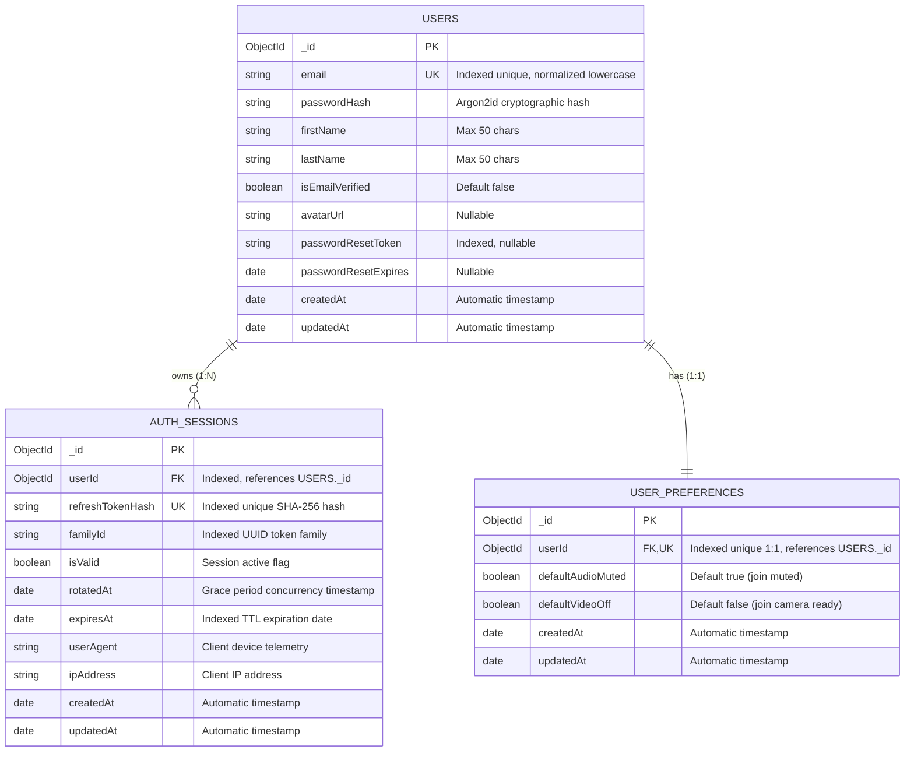

# CONNECTLY — PHASE 07 DATABASE DESIGN DOCUMENT
## DATABASE ARCHITECTURE, SCHEMAS & CONSTRAINTS

---

## 1. Overview & Architectural Goals

The CONNECTLY database foundation is engineered to provide high-concurrency real-time collaboration persistence with strict consistency, sub-millisecond document lookups, and airtight multi-tenant user isolation.

The persistent storage layer uses **MongoDB** with **Mongoose ODM** on Node.js/TypeScript.

Key design goals:
1. **Strict 1:1 Identity and Preference Isolation:** A user cannot view or mutate another user's profile, sessions, or meeting preferences.
2. **Deterministic Default Settings:** Audio muted (`true`) and video camera off (`false`) are enforced on initial creation and pre-join entry.
3. **Resilient Lifecycle Operations:** Connection timeouts, connection pooling, and connection health states are explicitly monitored to prevent deadlocks and unhandled disconnections.
4. **Security by Design:** Sensitive authentication credentials (passwords, tokens) are never stored in plaintext and never exposed on user profile or preference endpoints.

---

## 2. Entity-Relationship Model



---

## 3. Detailed Collection Schemas

### 3.1 `users` Collection
- **Collection Name:** `'users'`
- **Mongoose Model:** `User`
- **Purpose:** Primary identity records for authenticated platform participants.

| Field | Type | Required | Constraints / Defaults | Description |
| :--- | :--- | :---: | :--- | :--- |
| `_id` | `ObjectId` | Yes | Auto-generated PK | Unique identifier |
| `email` | `String` | Yes | Unique, lowercase, trimmed, RFC 5322 regex | Primary login identifier |
| `passwordHash` | `String` | Yes | Argon2id hash | Cryptographically secure hash string |
| `firstName` | `String` | Yes | Trimmed, 1–50 chars | Participant first name |
| `lastName` | `String` | Yes | Trimmed, 1–50 chars | Participant last name |
| `isEmailVerified` | `Boolean` | Yes | Default: `false` | Email verification flag |
| `avatarUrl` | `String` | No | Nullable | Profile image URI |
| `passwordResetToken` | `String` | No | Nullable, Indexed | One-time password reset token |
| `passwordResetExpires`| `Date` | No | Nullable | Password reset token expiry |
| `createdAt` | `Date` | Yes | Auto-managed timestamp | Account creation timestamp |
| `updatedAt` | `Date` | Yes | Auto-managed timestamp | Last profile update timestamp |

**Indexes:**
1. `_id_`: Unique primary index on `_id`.
2. `email_1`: Unique index on `email` to guarantee email exclusivity.
3. `passwordResetToken_1`: Sparse index on `passwordResetToken` for lookup speed.
4. `createdAt_-1`: Descending index on `createdAt` for audit sorting.

---

### 3.2 `auth_sessions` Collection
- **Collection Name:** `'auth_sessions'`
- **Mongoose Model:** `AuthSession`
- **Purpose:** Token family rotation state, concurrency grace period tracking, and multi-device session governance.

| Field | Type | Required | Constraints / Defaults | Description |
| :--- | :--- | :---: | :--- | :--- |
| `_id` | `ObjectId` | Yes | Auto-generated PK | Session document ID |
| `userId` | `ObjectId` | Yes | References `User._id` | Owning user ID |
| `refreshTokenHash` | `String` | Yes | Unique, 64-hex SHA-256 | Deterministic hash of refresh token |
| `familyId` | `String` | Yes | UUID string | Token rotation lineage family |
| `isValid` | `Boolean` | Yes | Default: `true` | Session validity status |
| `rotatedAt` | `Date` | No | Nullable | Concurrency grace period timestamp |
| `expiresAt` | `Date` | Yes | Expiry timestamp (7 days) | TTL expiration timestamp |
| `userAgent` | `String` | No | Nullable | Client device telemetry |
| `ipAddress` | `String` | No | Nullable | Client IP address |
| `createdAt` | `Date` | Yes | Auto-managed timestamp | Issuance timestamp |
| `updatedAt` | `Date` | Yes | Auto-managed timestamp | Last modification timestamp |

**Indexes:**
1. `_id_`: Unique primary index.
2. `refreshTokenHash_1`: Unique index for instant lookups during refresh operations.
3. `userId_1_isValid_1`: Compound index for user session revocation queries.
4. `expiresAt_1`: TTL index for automated document eviction.
5. `familyId_1`: Token family lineage lookups.
6. `familyId_1_isValid_1`: Compound index for family revocation upon reuse detection.

---

### 3.3 `user_preferences` Collection
- **Collection Name:** `'user_preferences'`
- **Mongoose Model:** `UserPreferences`
- **Purpose:** Persisting user-level default audio, video, and lobby behavior settings across devices and browser sessions.

| Field | Type | Required | Constraints / Defaults | Description |
| :--- | :--- | :---: | :--- | :--- |
| `_id` | `ObjectId` | Yes | Auto-generated PK | Unique preferences document ID |
| `userId` | `ObjectId` | Yes | Unique, References `User._id` | 1:1 user owner identifier |
| `defaultAudioMuted` | `Boolean` | Yes | Default: `true` | Microphone default state in lobby |
| `defaultVideoOff` | `Boolean` | Yes | Default: `false` | Camera default state in lobby |
| `createdAt` | `Date` | Yes | Auto-managed timestamp | Document creation timestamp |
| `updatedAt` | `Date` | Yes | Auto-managed timestamp | Last modification timestamp |

**Indexes:**
1. `_id_`: Unique primary index.
2. `userId_1`: **Unique constraint index** guaranteeing that no user can possess more than one preferences document in MongoDB.

---

## 4. Connection Resilience & Pool Configuration

Database connection logic is implemented in [database.ts](file:///c:/Users/SANJEET%20CHAUHAN/Desktop/code%20Alpha/antigravity%20communication%20application/server/src/config/database.ts).

### 4.1 Connection Settings
- **`connectTimeoutMS: 10000` (10,000ms):** Connection establishment timeout. If MongoDB cannot be reached within 10 seconds, the driver fails fast rather than hanging indefinitely.
- **`serverSelectionTimeoutMS: 5000` (5,000ms):** Server selection timeout for cluster topologies and failovers. Prevents API threads from accumulating blocked I/O during node re-elections.
- **`maxPoolSize: 50`:** Connection pool size tailored for concurrent API queries and real-time token verifications.
- **`minPoolSize: 5`:** Minimum idle connections kept warm for instantaneous response.

### 4.2 Lifecycle Event Listeners
```typescript
mongoose.connection.on('connected', () => {
  logger.info('Database connection established successfully');
});

mongoose.connection.on('error', (err) => {
  logger.error('Database connection error occurred', {
    error: err.message,
  });
});

mongoose.connection.on('disconnected', () => {
  logger.warn('Database disconnected');
});

mongoose.connection.on('reconnected', () => {
  logger.info('Database reconnected successfully');
});
```

### 4.3 Connection State Inspection
- `isDatabaseConnected(): boolean`: Returns `true` only when `mongoose.connection.readyState === 1`.
- `getDatabaseState()`: Returns normalized status string (`'disconnected'`, `'connected'`, `'connecting'`, `'disconnecting'`) and numeric `readyState`.

---

## 5. Data Isolation & Security Guarantees

1. **Cross-Tenant Isolation:**
   - Every read and write to `user_preferences` is scoped strictly by `userId: req.user.id`.
   - The user cannot supply a target `userId` in the request body; the authenticated JWT claims provide the sole authorizer.
   - Any attempt by User A to alter preferences for User B produces zero effect on User B's record.

2. **Atomic Upsert Mutation:**
   - Preference mutations utilize `findOneAndUpdate({ userId }, { $set: updateFields }, { upsert: true, new: true, setDefaultsOnInsert: true })`.
   - This eliminates race conditions during initial account onboarding, guaranteeing that exactly one preferences document exists per user.

3. **Mass Assignment Prevention:**
   - Strict Zod validation (`.strict()`) disallows extraneous parameters (e.g. `role`, `isAdmin`, `isEmailVerified`, `_id`, `userId`). Any unexpected keys trigger `400 Bad Request`.

4. **Credential Sanitization:**
   - Connection URIs are scrubbed with regex `mongodb(?:\+srv)?:\/\/[^@]+@` replacing credentials with `***:***@` before logging.
   - User profile queries execute `.select('-passwordHash -passwordResetToken -passwordResetExpires')`.
