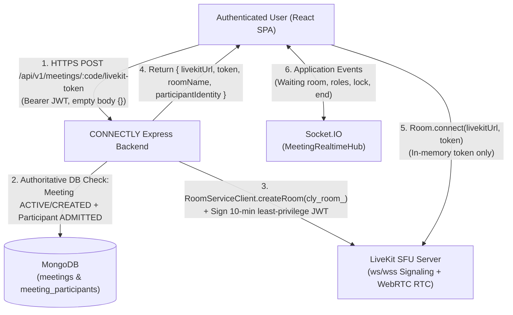

# CONNECTLY — Phase 09 Architecture & Integration Design

**Phase:** 09 – WebRTC + LiveKit Integration  
**SFU Engine:** LiveKit Server (`v1.13.11` tested locally; compatible with LiveKit Cloud & self-hosted deployments)  
**SDKs:** `livekit-server-sdk@2.20.0` (backend), `livekit-client@2.24.1` (frontend)

---

## 1. End-to-End Integration Architecture

---

## 2. Clean Separation of Responsibilities

| Subsystem | Source of Truth | Responsibilities | Explicitly Excluded |
| --- | --- | --- | --- |
| **MongoDB (`meetings`, `meeting_participants`)** | **Authoritative SSOT** | Meeting lifecycle (`CREATED/ACTIVE/ENDED/EXPIRED`), admission status (`WAITING/ADMITTED/REJECTED/LEFT/REMOVED/CANCELLED`), roles (`host/co-host/participant`), lock state, capacity | Never overridden by LiveKit room presence |
| **Socket.IO (`MeetingRealtimeHub`)** | Application Event Bus | Real-time waiting-room queue, admit/reject push, role updates, lock/unlock, removal notices, meeting termination broadcasts | Never carries WebRTC media, never carries LiveKit JWTs or API secrets |
| **LiveKit SFU (`livekit-server` + `livekit-client`)** | Real-Time Media Transport | WebRTC signaling, ICE/DTLS transport, SFU room connectivity, genuine connection/reconnection state, remote SFU peer join/leave events | Never decides CONNECTLY admission or roles; never holds client-supplied grants |

---

## 3. SDK Evaluation Decision (`livekit-client` vs `@livekit/components-react`)

Per Section 8 & Section 18:
- **Installed:** `livekit-server-sdk@2.20.0` (server) and `livekit-client@2.24.1` (client).
- **Evaluated & Deferred:** `@livekit/components-react` (`2.9.25`) and `@livekit/components-styles` were intentionally NOT installed in Phase 09 because Phase 09 establishes secure signaling and room connectivity without Phase 10 video grids, track carousels, or audio/video bars. Using `livekit-client` directly inside `LiveKitRoomController` + `useLiveKitConnection` gives deterministic React StrictMode cleanup, zero listener leaks, exact connection-state visibility, and zero unused UI-kit bundle weight. Phase 10 can adopt or compose video/audio rendering cleanly atop `LiveKitRoomController.getActiveRoom()`.

---

## 4. Deterministic Room & Participant Mapping

- **LiveKit Room Name:** `cly_room_<meetingId>` (24-char lowercase MongoDB ObjectId).
  - Stable across all users in the same meeting; guaranteed unique across different meetings; contains zero titles, emails, or client input.
- **LiveKit Participant Identity:** `usr_<userId>` (24-char lowercase MongoDB ObjectId).
  - Privacy-preserving opaque identifier; never uses emails, phone numbers, or mutable usernames.
- **Lifecycle Reconciliation:**
  - `removeParticipant` / `leaveMeeting`: best-effort `RoomServiceClient.removeParticipant(roomName, identity)` after authoritative DB commit.
  - `endMeeting` / last-host departure: `RoomServiceClient.deleteRoom(roomName)` with 1 bounded retry; if LiveKit is transiently unreachable during deletion, LiveKit's configured `emptyTimeout: 300` automatically sweeps any empty orphaned room, and CONNECTLY's DB state (`ENDED`) immediately blocks all future token requests (`410 LIVEKIT_MEETING_ENDED`).
  - Host departure with remaining participants preserves Phase 08 deterministic host handover without deleting the LiveKit room.

---

## 5. Frontend Connection State Machine (`LiveKitRoomController`)

States supported without fake timers or simulated success:
`idle` -> `requesting_token` -> `connecting` -> `connected` <-> `reconnecting` -> `disconnected` / `failed` / `unauthorized` / `meeting_ended`.

- **Single-Room & StrictMode Safety:** Monotonic `attemptId` cancels any in-flight token fetch or `room.connect()` if the component unmounts, user leaves, or meeting ends.
- **In-Memory Tokens Only:** JWTs exist only as transient local variables in `connect()` and are never written to `localStorage`, `sessionStorage`, or cookies.
- **Authoritative Reconnect:** Clicking `Reconnect` first re-verifies CONNECTLY `GET /api/v1/meetings/:code/state` before requesting a fresh short-lived LiveKit token.
