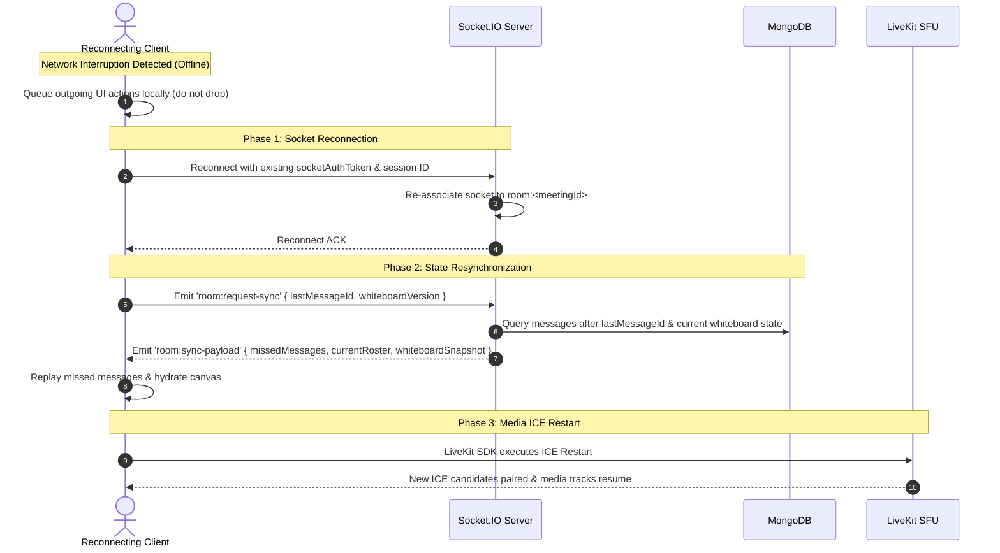

# CONNECTLY — Real-Time Event Architecture (Socket.IO & LiveKit)

## 1. Dual Real-Time Architecture & Clear Boundaries

CONNECTLY bifurcates its real-time layer into two discrete pipelines:
1. **LiveKit WebRTC SFU Pipeline:** Strictly dedicated to continuous isochronous media tracks:
   - Microphone audio (Opus with FEC/DTX)
   - Camera video (VP8/H.264 with 3-tier simulcast)
   - Screen share video (1080p high-resolution presentation track)
   - Screen share system audio
2. **Socket.IO Event Pipeline:** Strictly dedicated to discrete application-level signals:
   - Participant presence and room lifecycle
   - Waiting room queue and host admission decisions
   - Real-time text messaging and floating emoji reactions
   - Hand-raising priority queue
   - Collaborative whiteboard vector synchronization
   - Host moderation commands (remote mute, mute-all, ejection)

> **CRITICAL BOUNDARY ENFORCEMENT:** Socket.IO is NEVER used to forward raw video frames, audio blobs, or WebRTC media chunks. Video and audio are routed exclusively through LiveKit SFU.

---

## 2. Socket.IO Connection & Authentication Lifecycle

1. **Handshake Authentication:** The client establishes a WebSocket connection to `/socket.io/` supplying a signed JWT ticket via `auth.token`:
   ```typescript
   const socket = io("https://connectly.io", {
     auth: { token: socketAuthToken },
     transports: ["websocket", "polling"]
   });
   ```
2. **Server-Side Middleware Verification:** The server decodes the token, extracts `userId`, `meetingId`, and `role`, attaches identity metadata to `socket.data`, and associates the socket to a private socket ID and user ID room.
3. **Room Isolation:** Sockets are organized into two primary room channels per meeting:
   - `room:<meetingId>`: Active participants who have passed the waiting room.
   - `waiting:<meetingId>`: Unadmitted participants held in the waiting room.

---

## 3. Real-Time Events Catalog

### 3.1. Participant Lifecycle & Presence Events

| Event Name | Direction | Payload Shape | Authorization | Description |
| :--- | :--- | :--- | :--- | :--- |
| `room:join` | Client ➔ Server | `{ meetingCode: string, displayName: string }` | Valid Ticket | Requests formal admission to the active room. |
| `room:joined` | Server ➔ Client | `{ participantId: string, role: string, roster: Array<Participant> }` | Server ACK | Confirms admission and hydrates current participant list. |
| `participant:joined` | Server ➔ Room | `{ participant: Participant }` | Broadcast | Notifies active participants of a new member. |
| `participant:left` | Server ➔ Room | `{ participantId: string, reason: string }` | Broadcast | Notifies active participants of member departure. |
| `participant:heartbeat` | Client ➔ Server | `{ timestamp: number }` | Active Member | Heartbeat ping to monitor client connection health. |

#### Sample: `participant:joined` Payload
```json
{
  "participant": {
    "id": "6650d46084b3e8a1d044d404",
    "userId": "6650a12f84b3e8a1d044a101",
    "displayName": "Marcus Vance",
    "role": "participant",
    "isAudioMuted": true,
    "isVideoEnabled": false,
    "isScreenSharing": false,
    "isHandRaised": false,
    "joinedAt": "2026-05-15T10:02:15.000Z"
  }
}
```

---

### 3.2. Waiting Room & Host Admission Events

| Event Name | Direction | Payload Shape | Authorization | Description |
| :--- | :--- | :--- | :--- | :--- |
| `waiting:joined` | Server ➔ Client | `{ waitingTicket: string, position: number }` | Waiting Member | Confirms placement in waiting queue. |
| `waiting:participant-queued` | Server ➔ Host | `{ guestId: string, displayName: string, requestedAt: string }` | Host / Co-Host | Alerts hosts of a guest awaiting review. |
| `host:admit-participant` | Client ➔ Server | `{ guestId: string }` | Host / Co-Host | Host admits an individual guest. |
| `host:admit-all` | Client ➔ Server | `{}` | Host / Co-Host | Host admits all waiting guests simultaneously. |
| `host:deny-participant` | Client ➔ Server | `{ guestId: string }` | Host / Co-Host | Host rejects a waiting guest. |
| `waiting:admitted` | Server ➔ Target | `{ livekitToken: string, socketRoomToken: string }` | Server Target | Direct message to admitted guest granting entry tokens. |
| `waiting:denied` | Server ➔ Target | `{ reason: string }` | Server Target | Direct message notifying guest of rejection. |

---

### 3.3. In-Meeting Chat & Reaction Events

| Event Name | Direction | Payload Shape | Authorization | Description |
| :--- | :--- | :--- | :--- | :--- |
| `chat:send-message` | Client ➔ Server | `{ content: string, recipientId?: string }` | Active Member | Sends a public or direct chat message. |
| `chat:new-message` | Server ➔ Room/Target| `{ message: Message }` | Server Relay | Dispatches message to room or private recipient. |
| `chat:send-reaction` | Client ➔ Server | `{ emoji: string }` | Active Member | Dispatches a transient floating emoji. |
| `chat:new-reaction` | Server ➔ Room | `{ senderId: string, displayName: string, emoji: string }` | Broadcast | Instructs clients to animate floating reaction. |

#### Sample: `chat:send-reaction` Payload
```json
{
  "senderId": "6650b99984b3e8a1d044b999",
  "displayName": "Marcus Vance",
  "emoji": "🎉"
}
```

---

### 3.4. Hand Raising & Priority Queue Events

| Event Name | Direction | Payload Shape | Authorization | Description |
| :--- | :--- | :--- | :--- | :--- |
| `hand:toggle` | Client ➔ Server | `{ isRaised: boolean }` | Active Member | Participant toggles their raised hand. |
| `hand:state-changed` | Server ➔ Room | `{ participantId: string, isRaised: boolean, raisedAt: string }` | Broadcast | Updates visual hand badge and host priority queue. |
| `host:lower-hand` | Client ➔ Server | `{ participantId: string }` | Host / Co-Host | Host manually lowers a participant's hand. |

---

### 3.5. Collaborative Whiteboard Events

| Event Name | Direction | Payload Shape | Authorization | Description |
| :--- | :--- | :--- | :--- | :--- |
| `whiteboard:draw-stroke` | Client ➔ Server | `{ stroke: WhiteboardElement }` | Unlocked / Permitted | Emits a completed or in-progress vector delta. |
| `whiteboard:stroke-added`| Server ➔ Room | `{ stroke: WhiteboardElement }` | Broadcast (exclude sender) | Replicates vector stroke to all peer canvases. |
| `whiteboard:cursor-move` | Client ➔ Server | `{ x: number, y: number }` | Active Member | Streams active drawing cursor position. |
| `whiteboard:cursor-update`| Server ➔ Room | `{ participantId: string, name: string, x: number, y: number }` | Broadcast (throttle 50ms) | Renders collaborative laser/pointer cursors. |
| `whiteboard:clear` | Client ➔ Server | `{}` | Host / Co-Host | Wipes the active canvas. |
| `whiteboard:cleared` | Server ➔ Room | `{ clearedBy: string }` | Broadcast | Instructs all canvases to clear their buffer. |
| `whiteboard:lock-state` | Server ➔ Room | `{ isLocked: boolean, lockedBy: string }` | Broadcast | Locks canvas to prevent participant drawing. |

#### Sample: `whiteboard:draw-stroke` Payload
```json
{
  "stroke": {
    "id": "strk_99128ab",
    "tool": "pen",
    "points": [[150, 220], [152, 225], [160, 240]],
    "color": "#168B83",
    "width": 3,
    "opacity": 1.0
  }
}
```

---

### 3.6. Host Moderation & Governance Events

| Event Name | Direction | Payload Shape | Authorization | Description |
| :--- | :--- | :--- | :--- | :--- |
| `host:mute-participant` | Client ➔ Server | `{ participantId: string }` | Host / Co-Host | Mutes a specific participant's microphone. |
| `host:mute-all` | Client ➔ Server | `{ allowUnmute: boolean }` | Host / Co-Host | Mutes all non-host participants. |
| `participant:muted-by-host`| Server ➔ Target | `{ by: string, allowUnmute: boolean }` | Target Member | Forces local microphone track to disable. |
| `host:eject-participant`| Client ➔ Server | `{ participantId: string, banDurationMinutes: number }` | Host / Co-Host | Ejects participant from the meeting. |
| `participant:ejected` | Server ➔ Target | `{ reason: string }` | Target Member | Terminates socket and media session. |
| `host:update-room-settings`| Client ➔ Server | `{ settings: Partial<RoomSettings> }` | Host | Updates meeting security/feature flags on the fly. |
| `room:settings-updated` | Server ➔ Room | `{ settings: RoomSettings }` | Broadcast | Reconciles active room settings across all clients. |

---

## 4. Reconnection & State Recovery Workflow

Network interruptions (e.g., roaming from Wi-Fi to cellular) are handled with an automated three-phase recovery protocol:



---

## 5. Horizontal Scaling via Redis Adapter

To support thousands of concurrent users across distributed Node.js instances, Socket.IO is configured with `@socket.io/redis-adapter`:

```
                       ┌─────────────────────────┐
                       │   Load Balancer (AWS)   │
                       └────────────┬────────────┘
                                    │ Sticky Sessions (ip_hash)
                      ┌─────────────┴─────────────┐
                      ▼                           ▼
            ┌───────────────────┐       ┌───────────────────┐
            │  Socket Server A  │       │  Socket Server B  │
            └─────────┬─────────┘       └─────────┬─────────┘
                      │                           │
                      ▼                           ▼
            ┌───────────────────────────────────────────────┐
            │       Redis Cluster / PubSub Channel          │
            │           (socket.io room routing)            │
            └───────────────────────────────────────────────┘
```
- Sticky sessions are enforced at the reverse proxy to guarantee WebSocket upgrade affinity.
- Redis Pub/Sub fans out room broadcasts across all cluster instances so clients on Server A receive messages published by clients on Server B seamlessly.
