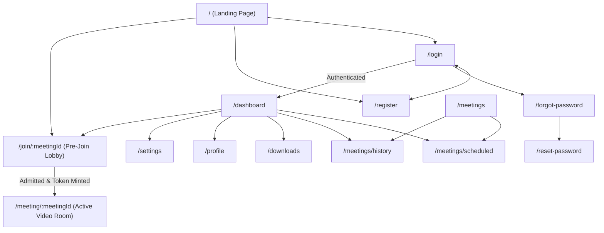
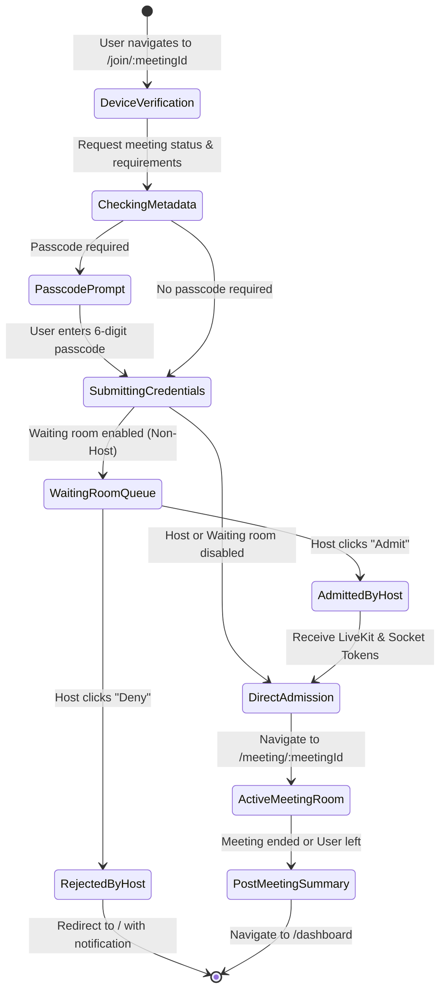

# CONNECTLY — Application Route Map & Navigation Architecture

## 1. Route Topology & Access Guard Model

CONNECTLY structures its client routing into three distinct access tiers:
1. **Public Unauthenticated Routes:** Accessible to all visitors; authenticated users hitting auth pages are automatically redirected to `/dashboard`.
2. **Semi-Public / Gated Meeting Entry:** Pre-join lobby allowing both authenticated users and authenticated guests to configure audio/video devices and submit credentials.
3. **Protected Authenticated Routes:** Strict authentication guard requiring a valid session; unauthenticated attempts are redirected to `/login?redirect=<target>`.

---

## 2. Route Specification Matrix

| Route URI | Access Tier | Guard Mechanism | Component Layout Shell | Description & Navigation Behavior |
| :--- | :--- | :--- | :--- | :--- |
| `/` | Public | None | Marketing Shell | Product vision, feature showcase, "Start Meeting" and "Sign In" CTAs. |
| `/login` | Public | Guest-Only Guard | Auth Centered Card | User authentication form. If already logged in, redirects to `/dashboard`. |
| `/register` | Public | Guest-Only Guard | Auth Centered Card | User registration form with live password complexity validation. |
| `/forgot-password`| Public | Guest-Only Guard | Auth Centered Card | Email input to request password reset dispatch. |
| `/reset-password` | Public | Token Required | Auth Centered Card | Password reset form requiring valid `?token=...` query param. |
| `/join/:meetingId`| Semi-Public | Lobby Gate | Pre-Join Shell | **Pre-Join Screen:** Camera/mic preview, device selection, display name (if guest), passcode input. |
| `/meeting/:meetingId`| Protected / Token | Room Token Guard| Dark Theater Shell | **Active Conference Room:** Full-screen LiveKit video grid, Socket.IO real-time collaboration. |
| `/dashboard` | Protected | Auth Guard | Warm Ivory Dashboard | Primary user workspace: instant meeting start, join by code, upcoming calendar, quick stats. |
| `/meetings` | Protected | Auth Guard | Warm Ivory Dashboard | Meetings hub; defaults to `/meetings/scheduled`. |
| `/meetings/scheduled`| Protected | Auth Guard | Warm Ivory Dashboard | Scheduled meetings calendar, creation modal, copy invite links, `.ics` export. |
| `/meetings/history`| Protected | Auth Guard | Warm Ivory Dashboard | Historical log of attended and hosted meetings, attendance durations, transcripts. |
| `/downloads` | Protected | Auth Guard | Warm Ivory Dashboard | User-accessible files shared across meetings they participated in. |
| `/profile` | Protected | Auth Guard | Warm Ivory Dashboard | Display name, avatar image upload, email verification, password update. |
| `/settings` | Protected | Auth Guard | Warm Ivory Dashboard | Default audio/video device preferences, noise suppression, notification settings. |
| `*` (404) | Public | None | Minimal Shell | Custom error screen with "Return to Safety" navigation. |

---

## 3. Deep Dive: Pre-Join & Meeting Entry Lifecycle (`/join/:id` ➔ `/meeting/:id`)

The transition from pre-join lobby to active room is a multi-step deterministic state machine:

### Route Behavior Rules:
1. **Direct Navigation to `/meeting/:meetingId`:** If a user pastes `/meeting/:meetingId` directly into their browser, the application router intercepts the request. If no valid LiveKit room token is present in the local application state, the user is automatically redirected to `/join/:meetingId` to complete device setup, passcode submission, and waiting room gating.
2. **Guest Entry:** Guests joining via `/join/:meetingId` are prompted for a `displayName`. They do not require an account. Upon meeting exit, guests are routed to a clean "Thank You" post-meeting feedback page rather than `/dashboard`.
3. **Session Interruption Recovery:** If a user accidentally refreshes their browser during an active meeting at `/meeting/:meetingId`, the client attempts a silent token revalidation using cached session credentials to rejoin within 3 seconds without forcing the user through the waiting room again.
