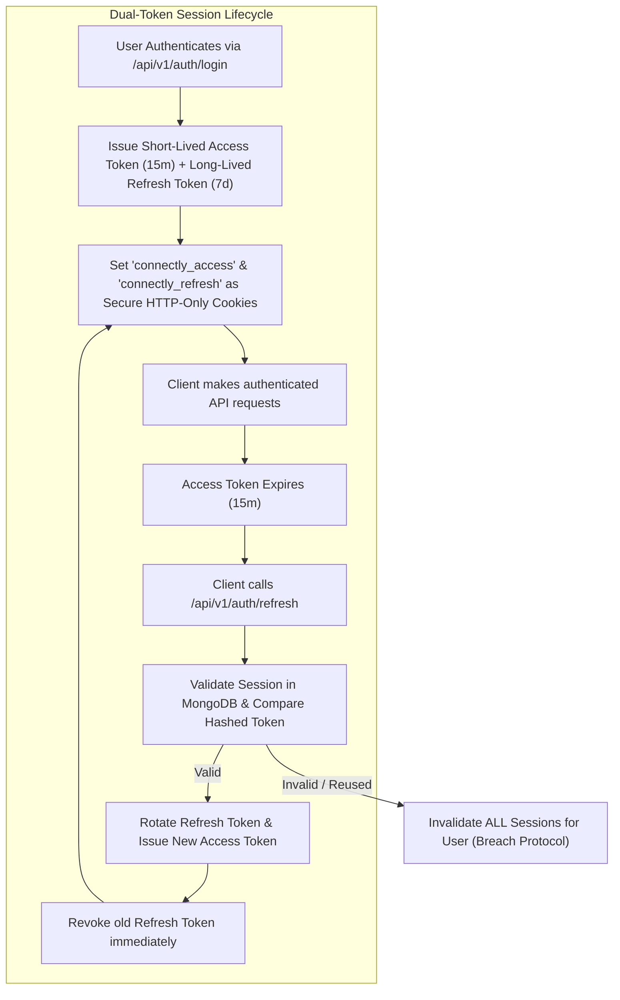

# CONNECTLY — Security, Privacy & Compliance Architecture

## 1. Security Principles & Threat Model

CONNECTLY adheres to a defense-in-depth security model designed to safeguard user identity, prevent unauthorized meeting intrusion, protect exchanged documents, and maintain operational integrity.

### Threat Model Matrix
| Threat Scenario | Impact | Mitigation Mechanism |
| :--- | :--- | :--- |
| **Meeting Bombing / Intrusion** | Unauthorized disruption of active rooms | Cryptographic meeting codes, optional passcodes, waiting rooms, and signed LiveKit tokens. |
| **Credential Stuffing / Brute Force** | Account takeover | Strict rate limiting on `/api/v1/auth/login`, Argon2id hashing, and account lockout alerts. |
| **Session Hijacking** | Impersonation of legitimate user | HTTP-only, secure, `SameSite=Lax` cookies; refresh token rotation; IP/User-Agent fingerprint hashing. |
| **Malicious File Ingestion** | Malware distribution via shared files | Strict MIME whitelisting, magic byte signature inspection, 25MB size limit, direct S3 upload, and quarantine metadata. |
| **Media Stream Interception** | Eavesdropping on conversations | Mandatory DTLS 1.2/1.3 and SRTP; short-lived LiveKit join tokens with cryptographic grants. |
| **Data Scraping / API Abuse** | Extraction of user or meeting data | Token-gated APIs, query limits, Helmet security headers, and strict CORS policies. |

---

## 2. Authentication & Session Lifecycle



### 2.1. Cryptographic Password Hashing
- **Algorithm:** **Argon2id** (v=19).
- **Parameters:**
  - Memory cost: `65536` KB (64 MB)
  - Time cost (iterations): `3`
  - Parallelism: `1` thread
- **Entropy & Salt:** Salts are 16-byte cryptographically secure random sequences generated natively by the Argon2 implementation.
- **Fallback:** In the event that native compilation is unavailable in restricted deployment environments, a modular fallback to `bcrypt` (work factor 12) is executed with active alerts.

### 2.2. Token Architecture & Storage
- **Access Token:**
  - Standard: JWT (JSON Web Token), signed with HMAC-SHA256 (`JWT_ACCESS_SECRET`).
  - Payload: `{ sub: userId, email: string, role: string, exp: number }`.
  - Expiration: `15 minutes`.
  - Storage: Transported via `Authorization: Bearer` or `connectly_access` cookie (`HttpOnly: true`, `Secure: true`, `SameSite: Lax`, `Path: /`).
- **Refresh Token:**
  - Format: 64-character cryptographically secure hex string.
  - Storage in Database: Stored exclusively as a SHA-256 hash in the `auth_sessions` collection. The plaintext token is never stored in the database.
  - Expiration: `7 days`.
  - Token Rotation: Every successful refresh generates a brand new refresh token and immediately invalidates the previous token. If an already-invalidated token is presented, the system detects a potential token theft and terminates all active sessions for that user account.

---

## 3. Role-Based Access Control (RBAC) Matrix

CONNECTLY defines two levels of roles: **Global Roles** (platform-level) and **Meeting Roles** (room-level).

### 3.1. Meeting Roles Matrix
| Permission / Action | Host | Co-Host | Participant | Guest |
| :--- | :---: | :---: | :---: | :---: |
| **Admit / Deny from Waiting Room** | ✅ | ✅ | ❌ | ❌ |
| **Mute Individual Participant** | ✅ | ✅ | ❌ | ❌ |
| **Mute All Participants** | ✅ | ✅ | ❌ | ❌ |
| **Eject Participant from Room** | ✅ | ✅ | ❌ | ❌ |
| **Promote Participant to Co-Host** | ✅ | ❌ | ❌ | ❌ |
| **Toggle Whiteboard Lock** | ✅ | ✅ | ❌ | ❌ |
| **Terminate Meeting for All** | ✅ | ❌ | ❌ | ❌ |
| **Publish Audio / Video** | ✅ | ✅ | ✅ | Host Permit |
| **Share Screen** | ✅ | ✅ | Host Permit | Host Permit |
| **Send In-Meeting Chat** | ✅ | ✅ | ✅ | ✅ |
| **Upload / Download Files** | ✅ | ✅ | ✅ | ❌ |
| **Draw on Collaborative Whiteboard**| ✅ | ✅ | If Unlocked | If Unlocked |

---

## 4. Input Validation & Defensive Coding

1. **Zod Validation Pipeline:** All incoming REST payloads, query parameters, and Socket.IO messages pass through explicit Zod schemas before hitting business logic:
   ```typescript
   export const JoinMeetingSchema = z.object({
     passcode: z.string().length(6).regex(/^[0-9]+$/).optional(),
     displayName: z.string().min(2).max(50).trim(),
     avatarUrl: z.string().url().optional().nullable()
   });
   ```
2. **HTML / Script Sanitization:** In-meeting chat messages are stripped of raw HTML, executable script tags, and malicious payloads using `DOMPurify` (client-side) and server-side text escaping.
3. **NoSQL Injection Prevention:** Mongoose schema definitions enforce strict typing; raw `$where` clauses and unfiltered client objects are strictly prohibited in database query selectors.

---

## 5. Rate Limiting Strategy

Rate limiting is enforced at the Express API layer using `express-rate-limit` paired with a Redis store:

| Endpoint Tier | Route Pattern | Rate Limit Window | Max Requests | Violation Action |
| :--- | :--- | :--- | :--- | :--- |
| **Authentication** | `/api/v1/auth/*` | 15 minutes | 10 per IP | HTTP 429 Too Many Requests |
| **Meeting Creation** | `/api/v1/meetings/instant` | 1 hour | 20 per User | HTTP 429 Too Many Requests |
| **Join Requests** | `/api/v1/meetings/:id/join` | 1 minute | 15 per IP | HTTP 429 & CAPTCHA trigger |
| **General API** | `/api/v1/*` | 1 minute | 120 per IP | HTTP 429 Too Many Requests |
| **Socket Chat Relay** | `chat:send-message` | 10 seconds | 10 messages | Socket warning & 30s mute |

---

## 6. CORS, CSRF & HTTP Security Headers

### 6.1. CORS Policy
- Allowed Origins: Strictly bound to `CLIENT_ORIGIN` (e.g., `https://connectly.io`). Wildcards (`*`) are disallowed when `credentials: true`.
- Allowed Methods: `GET`, `POST`, `PATCH`, `DELETE`, `OPTIONS`.
- Allowed Headers: `Content-Type`, `Authorization`, `X-Requested-With`.

### 6.2. CSRF Protection
- All state-altering API requests enforce custom headers (`X-Requested-With: XMLHttpRequest` or `Content-Type: application/json`).
- Cookies are provisioned with `SameSite: Lax` or `SameSite: Strict` to prevent cross-site request execution from malicious origins.

### 6.3. HTTP Security Headers (via Helmet)
- **Content-Security-Policy (CSP):**
  - `default-src 'self'`
  - `connect-src 'self' wss://connectly.io wss://sfu.connectly.io https://res.cloudinary.com https://*.amazonaws.com`
  - `media-src 'self' blob: mediastream:`
  - `img-src 'self' data: blob: https://res.cloudinary.com`
  - `frame-ancestors 'none'`
- **Strict-Transport-Security (HSTS):** `max-age=63072000; includeSubDomains; preload`
- **X-Content-Type-Options:** `nosniff`
- **X-Frame-Options:** `DENY`
- **Referrer-Policy:** `strict-origin-when-cross-origin`

---

## 7. File Security & Storage Isolation

1. **Direct-to-Storage Architecture:** Files are never streamed through the Express Node.js application process memory, eliminating server denial-of-service risks via memory exhaustion.
2. **Pre-Signed URL Restrictions:**
   - **Upload Pre-Signed URL:** Valid for 15 minutes. Bound to exact file size (`Content-Length`) and `Content-Type`.
   - **Download Pre-Signed URL:** Valid for 5 minutes. Generated only after server-side verification that the requesting user is an active participant in the associated meeting room.
3. **MIME & Magic Byte Verification:** Allowed formats are strictly restricted:
   - Permitted: `.pdf`, `.docx`, `.xlsx`, `.pptx`, `.png`, `.jpg`, `.jpeg`, `.zip`, `.txt`.
   - Prohibited: `.exe`, `.bat`, `.sh`, `.js`, `.vbs`, `.msi`, `.html`, `.svg` (to prevent SVG-based XSS).
   - Upon upload confirmation, file headers are validated against known magic byte signatures.

---

## 8. Logging, Observability & Secret Redaction

CONNECTLY uses **Pino** for structured JSON logging. All logs pass through an automated redaction filter:
- Redacted fields: `password`, `passwordHash`, `token`, `accessToken`, `refreshToken`, `authorization`, `cookie`, `secret`, `passcode`.
- Application secrets (`JWT_ACCESS_SECRET`, `LIVEKIT_API_SECRET`, `MONGODB_URI`) are injected strictly via environment variables and never logged or printed during bootstrap.

---

## 9. Encryption Boundaries: Transport vs. True E2EE

It is critical to maintain architectural honesty regarding encryption boundaries:

```
┌─────────────────────────────────────────────────────────────────────────────┐
│                    TRANSPORT ENCRYPTION (STANDARD IN SFU)                   │
│                                                                             │
│   Client A ──────────[ DTLS-SRTP ]──────────► LiveKit SFU Node              │
│   (Encrypted)                             (Terminates DTLS-SRTP,            │
│                                            Inspects RTP Headers,            │
│                                            Routes Media Tracks)             │
│                                                    │                        │
│   Client B ◄─────────[ DTLS-SRTP ]─────────────────┘                        │
│   (Encrypted)                                                               │
└─────────────────────────────────────────────────────────────────────────────┘

┌─────────────────────────────────────────────────────────────────────────────┐
│                 TRUE END-TO-END ENCRYPTION (E2EE / SFrame)                  │
│                                                                             │
│   Client A ──────────[ SFrame Encrypted Payload ]──────────► LiveKit SFU    │
│   (Frame Key K1)   over DTLS-SRTP                           (Cannot read    │
│                                                              payload frame) │
│                                                                    │        │
│   Client B ◄─────────[ SFrame Encrypted Payload ]──────────────────┘        │
│   (Has Key K1)                                                              │
└─────────────────────────────────────────────────────────────────────────────┘
```

### Clarification & Policy:
1. **Current Baseline (Phases 01–14):** The platform operates with **Robust Transport Encryption**:
   - Web application traffic is encrypted via **TLS 1.3** (HTTPS / WSS).
   - WebRTC media channels are encrypted via **DTLS 1.2 / 1.3** and **SRTP**.
   - *Architectural Truth:* Because LiveKit is an SFU, it terminates the DTLS-SRTP connection in memory to inspect packet headers for simulcast routing and packet forwarding. Therefore, this is **Transport Encryption**, NOT End-to-End Encryption.
2. **True End-to-End Encryption (E2EE):**
   - True E2EE requires frame-level payload encryption using the **SFrame** specification (via WebRTC Insertable Streams), where encryption keys are negotiated exclusively between clients and never shared with the SFU or API server.
   - **Mandate:** True E2EE, including evaluation and implementation of SFrame where appropriate, will be formally architected, tested, and implemented in **Phase 15 – Encryption & Security**. Phase 16 remains strictly and exclusively dedicated to **Scheduling & Meeting History**. Under no circumstances shall marketing or UI copy claim "End-to-End Encryption" until Phase 15 SFrame implementation and verification are complete.
