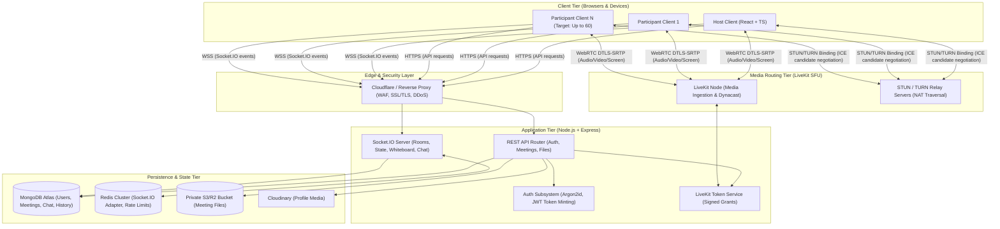
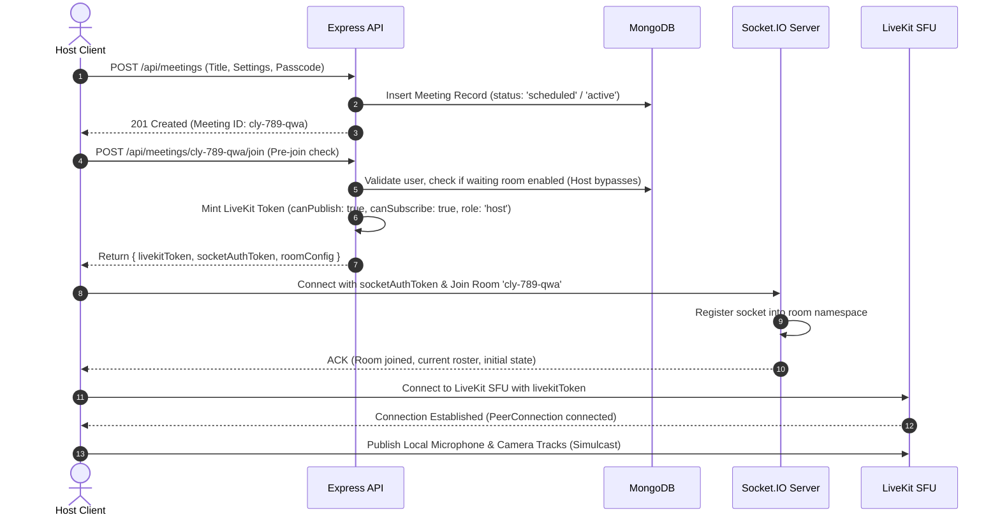
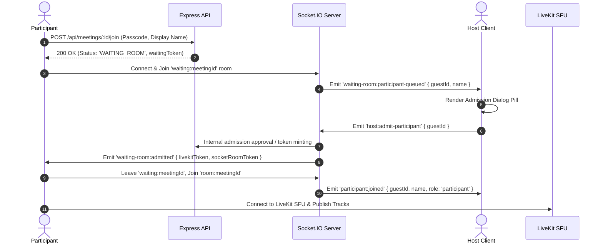
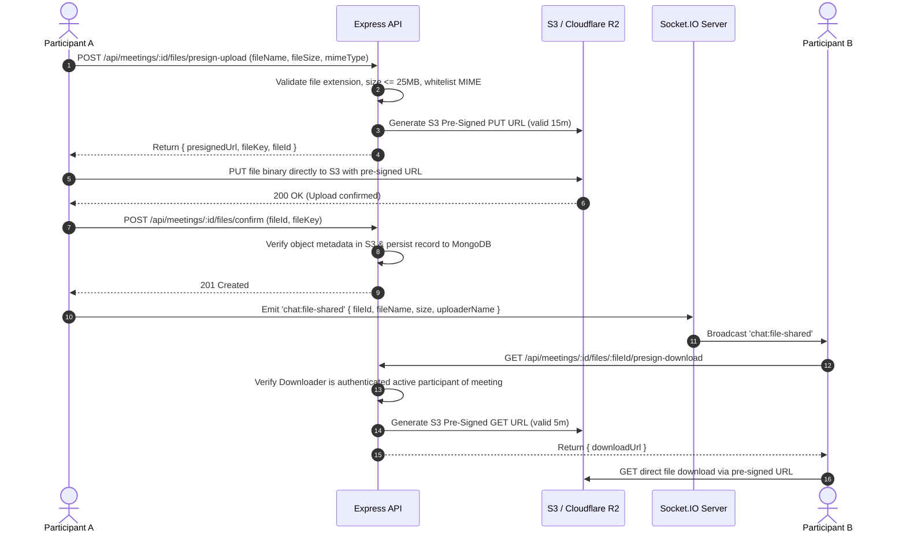
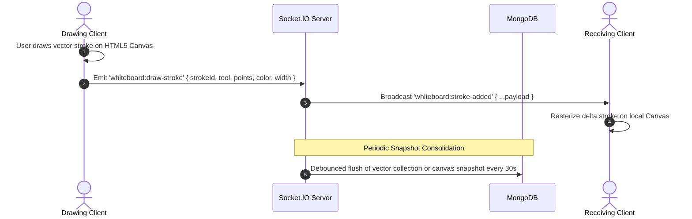

# CONNECTLY — System Architecture & Component Interactions

## 1. Architectural Topology

CONNECTLY employs a decoupled, asynchronous client-server architecture with specialized real-time conduits. High-bandwidth media streams are offloaded to dedicated WebRTC Selective Forwarding Units (LiveKit), while discrete operational signals, state synchronization, and persistent domain transactions are governed by the Express and Socket.IO application tiers.

---

## 2. Component Roles & Responsibilities

### 2.1. React Client Application
- **Responsibility:** User presentation, local state orchestration, media stream acquisition, hardware device negotiation, canvas rendering, and user input validation.
- **Key Modules:**
  - `MediaEngine`: Interfaces with `navigator.mediaDevices` and the `LiveKit SDK` to manage track capture, mute states, and audio level monitoring.
  - `RealtimeEngine`: Maintains the persistent Socket.IO connection, room membership, reconnection loops, and event dispatching.
  - `WhiteboardCanvas`: Hardware-accelerated 2D canvas/SVG rendering engine handling pointer events, vector interpolation, and delta dispatch.
  - `LayoutManager`: Dynamically recalculates video grid dimensions, active speaker prominence, and responsive mobile drawers.

### 2.2. Backend REST API (Express.js)
- **Responsibility:** Stateless business logic execution, user authentication, profile lifecycle, meeting scheduling, permission enforcement, and pre-signed storage credential generation.
- **Key Characteristics:**
  - Implements defensive input validation with Zod schemas.
  - Enforces strict rate limits on sensitive endpoints (`/api/auth/*`, `/api/meetings/join`).
  - Completely decoupled from media packet forwarding.

### 2.3. Authentication Subsystem
- **Responsibility:** Cryptographic identity verification, password hashing, credential issue, and session revocation.
- **Token Model:**
  - **Access Token:** Short-lived (15 minutes) signed JWT containing `userId`, `email`, and `globalRole`. Sent via secure, HTTP-only, `SameSite=Lax` cookie.
  - **Refresh Token:** Long-lived (7 days) cryptographically random UUID or signed JWT stored in a dedicated MongoDB `Session` collection with fingerprinting (User-Agent, IP hash). Supports immediate server-side revocation and token rotation on every refresh.
  - **LiveKit Room Token:** Short-lived (10 minutes) JWT signed with `LIVEKIT_API_SECRET` specifying exact `roomJoin`, `roomName`, `identity`, `canPublish`, and `canSubscribe` claims.

### 2.4. Database Tier (MongoDB Atlas)
- **Responsibility:** Authoritative persistent storage for non-transient platform data.
- **Collections:** `users`, `meetings`, `participants`, `messages`, `files`, `whiteboard_snapshots`, `notifications`, `meeting_history`, and `sessions`.
- **Durability:** WiredTiger engine with replica sets, automatic failover, point-in-time recovery, and encrypted data at rest.

### 2.5. Socket.IO Real-Time Server
- **Responsibility:** Low-latency state synchronization, user presence, room coordination, in-meeting chat, floating emoji broadcast, waiting room management, and collaborative whiteboard vector streaming.
- **Scaling:** Multiplexed via `@socket.io/redis-adapter` across multiple Node.js instances to allow horizontal clustering.

### 2.6. LiveKit SFU (Selective Forwarding Unit)
- **Responsibility:** Ingestion, transcoding-free routing, and forwarding of WebRTC audio, video, and screen share RTP streams.
- **Key Features:**
  - **Simulcast Ingestion:** Ingests high, medium, and low quality video layers from each publisher.
  - **Dynacast:** Automatically requests publishers to drop video layers if no downstream subscriber needs them.
  - **Adaptive Streaming:** Downgrades subscriber track quality dynamically if receiver bandwidth or CPU throttles.
  - **Active Speaker Detection:** Calculates energy levels from audio RTP header extensions (`urn:ietf:params:rtp-hdrext:ssrc-audio-level`) and broadcasts dominant speaker events.

### 2.7. Private Storage Tier (AWS S3 / Cloudflare R2)
- **Responsibility:** Secure, durable hosting of files exchanged during meetings.
- **Security Boundary:** Zero public read or write access. Uploads and downloads are exclusively facilitated through time-delimited, single-use Pre-Signed URLs verified by the backend API.

---

## 3. End-to-End Communication Flows

### 3.1. Meeting Creation & Join Flow

### 3.2. Waiting Room & Participant Admission Flow

### 3.3. File Upload & Secure Download Flow

### 3.4. Whiteboard Collaborative Delta Flow

---

## 4. Failure Isolation & Graceful Degradation

| Failure Domain | Architectural Impact | Automatic Recovery Mechanism |
| :--- | :--- | :--- |
| **LiveKit SFU Node Glitch** | Media tracks temporarily freeze or disconnect. | Client detects `ConnectionState.Reconnecting`. LiveKit SDK attempts ICE restart; fallback to secondary SFU node if clustered. |
| **Socket.IO Worker Crash** | Signaling, chat, and whiteboard drop momentarily. | Client automatically reconnects with exponential backoff. `@socket.io/redis-adapter` re-routes socket traffic to surviving instances. Client emits state-resync on reconnect. |
| **Severe Downlink Congestion** | High packet loss (>10%), latency spike (>400ms). | LiveKit Dynacast steps video layer from High (720p) -> Mid (360p) -> Low (180p) -> Pauses non-speaking video tiles. Audio packets prioritized via Opus DTX. |
| **Client Camera Hardware Failure** | Media stream throws `NotReadableError` or track muting. | Client catches error, notifies user with descriptive banner, disables video button, and maintains audio-only session. |
| **Database Unavailability** | REST operations fail (scheduling, profile updates). | In-flight meetings remain connected because LiveKit and Socket.IO maintain active in-memory room sessions. |
